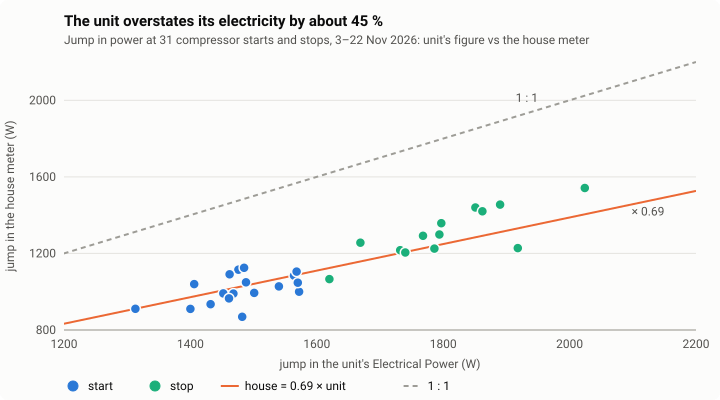
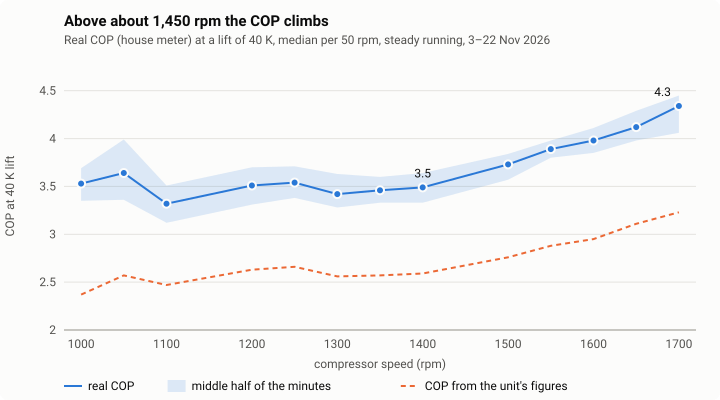
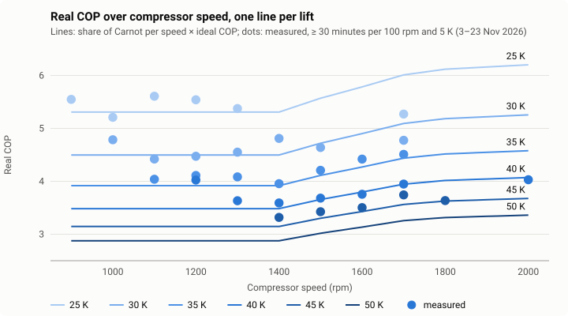
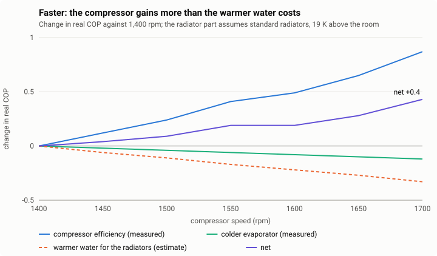
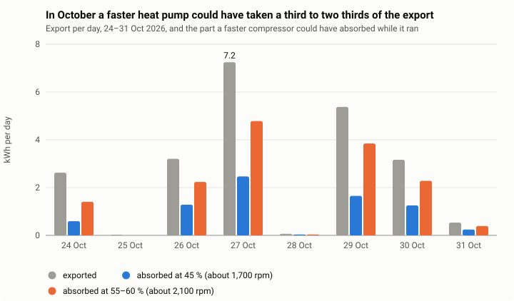

# COP, compressor speed and lift on a 12 kW unit

What three weeks of data from one LG Therma V R290 (12 kW, radiators, no DHW
tank) say about its efficiency: how much electricity it really uses, how good
the COP really is, and why the compressor works better at about 1,700 rpm than
at 1,400 rpm. The unit is the one in [findings.md](findings.md).

> **Status: in testing.** The analysis below led to a simpler AutoTemp that
> heats at the target from the start instead of holding the compressor back
> (see [What is being tested now](#what-is-being-tested-now)). It runs on the
> 12 kW unit from 23 November 2026; this page gets the results after a week or
> two. Until then, the example automations in [automations.md](automations.md)
> stay as they are.

## Contents

- [In short](#in-short)
- [The data](#the-data)
- [Electricity: the unit's figure is about 40 % too high](#electricity-the-units-figure-is-about-40--too-high)
- [Heat: reported and calculated agree, the flow sensor sets the limit](#heat-reported-and-calculated-agree-the-flow-sensor-sets-the-limit)
- [Lift: what the compressor has to overcome](#lift-what-the-compressor-has-to-overcome)
- [COP over compressor speed](#cop-over-compressor-speed)
- [COP over speed for each lift](#cop-over-speed-for-each-lift)
- [Why faster is more efficient](#why-faster-is-more-efficient)
- [The catch: more heat needs warmer water](#the-catch-more-heat-needs-warmer-water)
- [Whole days](#whole-days)
- [Solar: how much more the heat pump could take](#solar-how-much-more-the-heat-pump-could-take)
- [First day: max modulation 40–45 % without the morning ramp](#first-day-max-modulation-4045--without-the-morning-ramp)
- [What is being tested now](#what-is-being-tested-now)
- [How to repeat this on your own unit](#how-to-repeat-this-on-your-own-unit)
- [Limits](#limits)

## In short

| Finding | Result | Confidence |
|---|---|---|
| Electrical Power (input 34–45) against the house meter | over a day about **1.4 ×** the real energy (real ≈ **0.71** × unit); while running real ≈ 0.94 × unit − 355 W; at night, idle, about **13 W** instead of the 49 W reported | 🟢 31 starts and stops, 121 three-phase steps at 1-second resolution, October against November nights |
| Real COP at 1,400 rpm, about 6 °C outside | about **3.5** (the unit's own figures say 2.6) | 🟡 the flow sensor allows ±13 % |
| Real COP at 1,700 rpm, same conditions | about **4.3** (unit: 3.2) | 🟡 same |
| Gain from 1,400 to 1,700 rpm at the same lift | **+0.5 COP** | 🟢 210 matched minutes, 95 % of them better |
| Cost of each kelvin of lift | about **−0.115 COP** (about 3 %) | 🟢 fitted over 5,700 minutes |
| Net gain once the radiators need warmer water | about **+0.4 COP** at 1,700 rpm | 🟡 radiator part estimated, not measured |
| Max modulation → speed (23 Nov, inlet below the setpoint) | 41 % → **1,800 rpm**, 42 % → 1,860 rpm, 45 % → 1,980 rpm | 🟢 read directly |
| Real COP at 40 K lift, 41 % against 45 % | about **4.1** for both: above about 1,800 rpm the curve still rises, but only by about 1 % per 100 rpm | 🟡 one day, 44–112 minutes per setting |
| Whole days | **no gain visible yet** | 🔴 20 days, faster days were also colder |
| Unused solar (export) | November about **0.5 kWh/day**, late October about **2.8 kWh/day**; 93–97 % of it while the heat pump was already running | 🟢 house meter, 3–21 Nov and 24–31 Oct |
| Export a faster heat pump could have taken (24–31 Oct) | a third at 45 % modulation, **two thirds at 55–60 %** | 🟡 minute by minute, the heat pump's power from hourly averages |

## The data

- **Unit:** Home Assistant history of this integration, exported as CSV: compressor speed, *Electrical Power*, *Thermal Power (Reported)* and *(Calculated)*, flow, outdoor temperature, evaporator coil, high and low pressure. Only the minutes Home Assistant keeps raw were used (it keeps 10 days raw; older days are hourly averages and were left out), from two exports: **3–22 November 2026**, 20 days.
- **House meter:** the smart meter read by vzlogger, stored in VictoriaMetrics, in two resolutions:
  - **raw, one value per second** (1.7 million values, 3–22 November, `/api/v1/export` per day): for the calibration at 1-second resolution and the real power and energy factors;
  - **30-second averages** (`query_range` with `avg_over_time(...[30s])`, `step=30s`, in parts of eight days, as that API returns at most about 30,000 points per request): for the first comparison at the 31 starts and stops, and the minute values in the COP analysis.
  - **the three phases L1, L2, L3, raw, one value per second** (3–22 November): to tell the heat pump's steps from the rest of the house (see [Three phases](#three-phases-the-heat-pumps-steps-apart-from-the-house)). They add up to the total exactly, second by second.
  - **24–31 October during the day** (06:00–20:00, the three phases and the total, raw): for the [solar](#solar-how-much-more-the-heat-pump-could-take) analysis, with the heat pump's **hourly averages** from Home Assistant's long-term statistics for those days (compressor speed, *Electrical Power*, thermal power, outdoor temperature), as the raw history no longer exists.
  - **the nights of October** (00:00–06:00, the three phases and the total, raw): the heat pump was switched on, indoor and outdoor unit, on the morning of 23 October 2026, so the nights before and after give its real standby (see [Standby](#standby-october-against-november-nights)).
- **Unit side:** *Electrical Power* changes are recorded at the poll interval (about 10 s); its figure arrives about 40 s after the house meter sees a change, which the 1-second comparison corrects for.
- **Steady running:** compressor on for at least 20 minutes, the speed stable within ±30 rpm over 10 minutes, thermal power above 200 W, electrical above 300 W. **No defrosts:** minutes with a flow above 20 L/min or negative calculated heat, and the 15 minutes after them, were left out (the pump runs at about 34 L/min during a defrost).
- That leaves **5,713 steady minutes**.

## Electricity: the unit's figure is about 40 % too high

At every compressor start (about 08:00) and stop (about 16:00), the step in the house meter is the heat pump's real share: the rest of the house does not change within those few minutes, and at those hours there is little solar on the meter. The mean of five minutes before and after was compared, after the compressor had settled (8–13 minutes after a start, 2–7 minutes after a stop). Events where the house load itself jumped at the same time were left out (31 of 43 remained).



| Event | Unit's figure | House meter | House ÷ unit |
|---|---|---|---|
| Start, 22 Nov 08:02 | +1,462 W | +1,091 W | 0.75 |
| Start, 15 Nov 08:02 | +1,485 W | +1,125 W | 0.76 |
| Stop, 14 Nov 16:47 | −2,024 W | −1,542 W | 0.76 |
| Stop, 6 Nov 14:30 | −1,890 W | −1,455 W | 0.77 |
| Start, 7 Nov 08:32 | +1,482 W | +869 W | 0.59 |
| **All 31 (median)** | | | **0.69** (half between 0.67 and 0.75) |

Fitted over the range seen (1,300–2,000 W): **real ≈ 0.89 × unit − 300 W**. The error is relatively larger at low power. This matches the night pulses in [findings.md](findings.md#at-night-fan-runs-and-compressor-preheating) (about 300 W by the unit, about 180 W by the meter). Every COP built on *Electrical Power* is therefore too low. This was the first estimate; the real COPs on this page use the finer fit from the 1-second data below.

### At 1-second resolution: not one factor

The same comparison with the house meter's raw values (one per second, 1.7 million values, 3–22 November) instead of averages shows *which* part is too high. The unit's figure arrives about **40 seconds after** the house meter sees the change; with that delay corrected, every step of at least 100 W was taken where the unit's figure was stable for a minute before and after and nothing else in the house switched at the same time (101 of 151 steps):

| Situation | Steps | Typical step | House ÷ unit (median, middle half) |
|---|---|---|---|
| Speed changes while running | 84 | 210 W | **0.93** (0.75–1.09) |
| Starts and stops | 5 (31 above) | 1,700 W | **0.72** (0.72–0.73) |
| Compressor off: night preheating pulses | 12 | 280 W | **0.62** (0.41–0.71) |

So each *additional* watt while running is reported almost right, but the step from standby to running carries a roughly constant overstatement. Fitted on the house total (robust, the 89 steps with the compressor running): real ≈ 0.93 × unit − 340 W while running. The two numbers of that fit are uncertain on their own (bootstrap 90 %: slope 0.74–1.08, offset 10–580 W), as most steps are small and the rest of the house adds noise. The three phases narrow it down.

### Three phases: the heat pump's steps apart from the house

The heat pump is a **three-phase load**: each of its steps shows up on L1, L2 and L3 at the same time and is split evenly: each phase carries a third of what the meter sees (median 33 / 34 / 33 % for L1 / L2 / L3, 114 steps). Measured against the unit's own figure, each phase sees only about 29 %, together about 0.87, which is the overstatement again. Almost everything else in the house is single-phase. So a step that all three phases share is the heat pump; a step on one phase is something else. Kept were the steps where all three phases moved in the unit's direction and none carried more than 55 % of the sum (121 of 151):

| Steps | House ÷ unit (median, middle half) |
|---|---|
| Speed changes while running (103) | **0.96** (0.78–1.12) |
| Starts and stops (8) | **0.73** (0.72–0.75) |
| Compressor off (10), mostly the morning switch-on and preheating pulses | 0.66 (0.45–0.71) |

Fitted (robust, all running steps, the heat pump's part taken as three times the middle one of the three phase steps, so a single-phase load at the same moment drops out):

| Fit for the running compressor | Real power | Bootstrap 90 % |
|---|---|---|
| House total | 0.93 × unit − 340 W | 🟡 slope 0.74–1.08, offset 10–580 W |
| **Three phases** | **0.94 × unit − 355 W** | 🟢 slope 0.89–1.00, offset 250–460 W |

The factor therefore depends on the power level:

| Unit shows | Real (fitted) | Factor |
|---|---|---|
| 1,000 W | about 590 W | 0.59 |
| 1,500 W | about 1,060 W | 0.71 |
| 2,000 W | about 1,530 W | 0.76 |
| 2,500 W | about 2,000 W | 0.80 |

### Standby: October against November nights

With the compressor off at night, the unit reports a steady **49 W** (pump, controller, electronics). The steps are too small to measure that directly, but the nights before and after the heat pump was switched on (morning of 23 October 2026) are. The quietest minutes of each night (10th percentile of the one-minute means, 01:00–05:00), only nights without a computer that was sometimes left on (about 13 W on L3):

| Nights | L1 | L2 | L3 | Total |
|---|---|---|---|---|
| 1–22 October, heat pump off | 5.5 W | 5.3 W | 42.3 W | **53.6 W** (middle half 52.5–54.3) |
| from 24 October, heat pump on | 6.3 W | 13.1 W | 46.2 W | **65.9 W** (middle half 65.1–67.4) |
| **Difference = heat pump** | +0.8 W | +7.8 W | +4.0 W | **about 13 W** |

So the heat pump really draws **about 13 W** at night with the pump running, about a quarter of the 49 W it reports. The preheating pulses at night are a different load (current through the compressor windings, about 280 W by the unit, about 180 W by the meter, evenly on all three phases) and come out at about 0.62 × the unit's figure.

### Energy per day

Running 0.94 × unit − 355 W, idle about 13 W, preheating 0.62 × unit: over whole days the **real energy is 0.71 × the unit's** (every day between 0.68 and 0.73). The idle part is only about 5 % of the unit's energy, so the standby changes the factor by about 0.01 (0.72 before). **All real COPs on this page use this calibration**; against the house-total fit (0.93 × unit − 340 W) the running figures move by at most 0.03, the whole days by about +0.09 because of the lower standby.

**In Home Assistant**, two template sensors (*Settings → Devices & services → Helpers → Create helper → Template → Template a sensor*) give the real figures:

- *Heat pump energy (real)*, unit kWh, device class *Energy*, state class *Total increasing*:

  ```jinja
  
  {{ (x | float * 0.71) | round(2) if is_number(x) else none }}
  ```

- *Heat pump power (real)*, unit W, device class *Power*, state class *Measurement*:

  ```jinja
  
  
    
    
      {{ [x * 0.94 - 355, 0] | max | round(0) }}
    
      13
    
      {{ (x * 0.62) | round(0) }}
    
  none
  ```

`none` makes the sensor *unknown* during a Modbus hiccup instead of 0, which a *Total increasing* sensor would take as a meter reset. The factors are from this one unit; on another, measure them first. Whether the energy counter (input 38) is off by the same factor as the power register is assumed, not yet checked.

## Heat: reported and calculated agree, the flow sensor sets the limit

- *Thermal Power (Calculated)* is flow × (outlet − inlet) × 4186 J/(kg·K). With the compressor running, calculated ÷ reported has a median of **1.004** (half between 0.993 and 1.014). The unit evidently computes its reported heat from the same sensors, so the two are **not independent** of each other.
- **Temperature sensors:** at night, with the pump running and no heat, the calculated heat was exactly 0 W on all 2,640 minutes (1–5 am, 12–22 November): inlet and outlet read the same. An offset of 0.1 K would show up as about 80 W, so with the usual 6–7 K difference the zero error is below about 1.5 %.
- **Flow sensor:** a SIKA VVX20 (vortex, 5–80 L/min), datasheet accuracy ±2 % of the range, i.e. about **±1.5 L/min**; at 11–12 L/min that is up to **±13 %**. Its repeatability is ±0.5 %, so comparisons between minutes are reliable, the absolute level is not.

So all COPs here carry the flow sensor's uncertainty as one common factor: the *shape* of every result holds, the *level* may be up to about 13 % higher or lower. A heat meter in the heating circuit (MID class, about ±2–3 %) would pin it down.

## Lift: what the compressor has to overcome

The **lift** is the condensing temperature minus the evaporating temperature of the refrigerant, both worked out from the pressures (propane saturation, the pressures read as gauge pressure, see [findings.md](findings.md#the-pressures-are-gauge-pressures)). It is the temperature step the compressor has to pump the heat up. The smaller it is, the better the COP can be. The ideal (Carnot) COP for a lift is *T*<sub>condensing</sub> / lift in kelvin: at 43 °C and 40 K, 316 / 40 = 7.9.

Minutes at 5–7.5 °C outside:

| Speed | Minutes | Evaporating | Condensing | Lift | Water ΔT | Real COP | Share of ideal |
|---|---|---|---|---|---|---|---|
| below 1,300 rpm | 160 | 2.6 °C | 31.9 °C | 🟢 29.3 K | 5.6 K | 4.57 | 0.45 |
| 1,300–1,500 rpm | 1,539 | 2.6 °C | 42.7 °C | 🟡 40.3 K | 6.1 K | 3.54 | 0.44 |
| 1,550–1,650 rpm | 250 | 1.8 °C | 44.7 °C | 🟡 42.1 K | 6.9 K | 3.61 | 🟢 0.48 |
| 1,650–1,750 rpm | 106 | 1.8 °C | 43.7 °C | 🟡 42.0 K | 7.0 K | 3.80 | 🟢 0.50 |

Fitted over all steady minutes:

- **lift ≈ 0.93 × condensing − 0.89 × outdoor + 4.2 K per 1,000 rpm.** The water temperature sets the lift almost one to one; the speed adds a little, because a faster compressor pulls the coil colder and pushes the condenser warmer.
- **COP falls by about 0.115 per kelvin of lift** (about 3 %). The first row shows what that means: with water at about 32 °C instead of 43 °C, the lift is 11 K smaller and the COP 1 point higher.

## COP over compressor speed

To see the speed alone, each minute's real COP was moved to a common lift of 40 K with the 0.115 per kelvin from above, and the minutes were grouped per 50 rpm.



- **Up to about 1,400 rpm the curve is flat** at about 3.4–3.5.
- **From about 1,450 rpm it rises steadily**, by about 0.25 per 100 rpm, to about 4.3 at 1,700 rpm, with no sign of levelling off yet.
- The unit's own COP has the same shape, about one point lower: its electricity figure is too high.
- Above 1,750 rpm there was no steady running in these 20 days. The first day at 1,800–1,980 rpm ([below](#first-day-max-modulation-4045--without-the-morning-ramp)) shows the curve flattening there: about 4.0 at 1,800 rpm, 4.07 at 2,000 rpm ([by lift](#cop-over-speed-for-each-lift)). The bins below 1,100 rpm come from mild days with only about 27 K lift and need the largest correction; they are the least certain.

**Without the lift correction, matched instead:** every minute at a higher speed was compared with minutes at 1,300–1,500 rpm with the same outdoor temperature (±0.5 K) and the same condensing temperature (±1 K):

| Speed | Matched minutes | Real COP | Better in |
|---|---|---|---|
| 1,550–1,650 rpm | 346 | 🟢 +0.20 | 90 % |
| 1,650–1,750 rpm | 210 | 🟢 +0.46 | 95 % |

Sensor lag cannot explain it: during a speed-up the heat reading lags behind the electricity, which would make the faster minutes look *worse*. With the speed stable for 10 minutes the gap was, if anything, slightly larger.

## COP over speed for each lift

The curve above is at one lift (40 K). The same data split by lift, 3–23 November 2026, real electricity, steady running (from 10 minutes after a start, 3 minutes after a speed change):



The lines are a model built from two measured parts: the **share of Carnot** the compressor reaches at each speed (median per 100 rpm: 0.445 up to 1,400 rpm, 0.467 at 1,500, 0.485 at 1,600, 0.504 at 1,700, 0.513 at 1,800, 0.52 at 2,000) times the **ideal COP** of the lift, (condensing temperature in K) ÷ lift, with the refrigerant evaporating at 0 °C. The dots are the measured real COP per 100 rpm and 5 K of lift, where there were at least 30 minutes; in brackets in the table:

| Speed | 25 K | 30 K | 35 K | 40 K | 45 K | 50 K |
|---|---|---|---|---|---|---|
| 1,000 rpm | 5.31 (5.21) | 4.50 (4.78) | 3.92 | 3.48 | 3.15 | 2.88 |
| 1,200 rpm | 5.31 (5.54) | 4.50 (4.47) | 3.92 (4.11) | 3.48 (4.02) | 3.15 | 2.88 |
| 1,400 rpm | 5.31 | 4.50 (4.81) | 3.92 (3.96) | 3.48 (3.59) | 3.15 (3.32) | 2.88 |
| 1,500 rpm | 5.57 | 4.72 (4.64) | 4.11 (4.21) | 3.66 (3.68) | 3.30 (3.43) | 3.02 |
| 1,600 rpm | 5.78 | 4.90 | 4.27 (4.42) | 3.80 (3.75) | 3.43 (3.50) | 3.13 |
| 1,700 rpm | 6.01 (5.27) | 5.09 (4.77) | 4.44 (4.51) | 3.95 (3.95) | 3.56 (3.74) | 3.26 |
| 1,800 rpm | 6.12 | 5.18 | 4.52 | 4.02 | 3.63 (3.64) | 3.32 |
| 2,000 rpm | 6.20 | 5.25 | 4.58 | 4.07 (4.03) | 3.68 | 3.36 |

**The change against 1,000 rpm**, the same model. In percent it is the same at every lift (it is the share of Carnot); in COP points it is larger at low lift, where the COP is higher to begin with:

| Speed | Share of Carnot | Change | 25 K | 30 K | 35 K | 40 K | 45 K | 50 K |
|---|---|---|---|---|---|---|---|---|
| 1,000 rpm | 0.445 | – | – | – | – | – | – | – |
| 1,200 rpm | 0.445 | +0 % | +0.00 | +0.00 | +0.00 | +0.00 | +0.00 | +0.00 |
| 1,400 rpm | 0.445 | +0 % | +0.00 | +0.00 | +0.00 | +0.00 | +0.00 | +0.00 |
| 1,500 rpm | 0.467 | +5 % | +0.26 | +0.22 | +0.19 | +0.17 | +0.16 | +0.14 |
| 1,600 rpm | 0.485 | +9 % | +0.48 | +0.40 | +0.35 | +0.31 | +0.28 | +0.26 |
| 1,700 rpm | 0.504 | +13 % | +0.70 | +0.60 | +0.52 | +0.46 | +0.42 | +0.38 |
| 1,800 rpm | 0.513 | +15 % | +0.81 | +0.69 | +0.60 | +0.53 | +0.48 | +0.44 |
| 1,900 rpm | 0.516 | +16 % | +0.85 | +0.72 | +0.63 | +0.56 | +0.51 | +0.46 |
| 2,000 rpm | 0.520 | +17 % | +0.89 | +0.76 | +0.66 | +0.59 | +0.53 | +0.48 |

Between 1,000 and 1,400 rpm the share of Carnot stays at 0.44–0.45 in every 100 rpm bin (0.450, 0.438, 0.452, 0.452, 0.445, about 1,000 to 2,400 minutes each from 1,100 rpm on): the gain only starts above 1,400 rpm. Above 1,800 rpm the medians are 0.513, 0.526 (6 minutes) and 0.521 (94 minutes) at 1,800, 1,900 and 2,000 rpm; at the same lift (41–45 K) 2,000 rpm came out 0.2 above 1,800 rpm in raw COP, about half of which is 2 K less lift. The data so far (above 1,800 rpm all of it from 23 November) show **no drop** up to 2,000 rpm, only a gain that gets small.

How to read it:

- **Lift matters more than speed.** 5 K less lift is worth about 0.4–0.9 COP at any speed; going from 1,400 to 1,800 rpm is worth about 0.5 at 40 K. Cooler water (a lower target, bigger radiators) and milder air both lower the lift.
- **Above about 1,800 rpm every line flattens:** it still rises, by about 1 % per 100 rpm, so more speed mostly adds heat ([first day at 41–45 %](#first-day-max-modulation-4045--without-the-morning-ramp)).
- Where the model and the dots differ most: at 25–30 K and 1,700 rpm the measured COP is 0.3–0.7 lower. Those minutes are morning warm-ups with cold water, where the heat reading lags behind the rising water temperature; at 1,200 rpm and 40 K it is 0.5 higher, from mild days with a warm evaporator (7.5 °C), which the 0 °C of the model does not cover. Where most minutes are (35–45 K, 1,400–1,800 rpm) the two agree within about ±0.15.

## Why faster is more efficient

In the lift table, the share of the ideal COP rises from **0.44 at 1,400 rpm to 0.50 at 1,700 rpm**: the compressor itself works better. 1,400 rpm is about 23 Hz, the bottom of an inverter compressor's range. At low speed, more refrigerant leaks back inside the compressor and the motor and its inverter run at poor efficiency, so the same heat costs relatively more electricity. Compressors of this kind usually work best somewhere around 50–60 Hz (3,000–3,600 rpm); on this unit the gain flattens out already above about 1,750 rpm, at least in the range the max modulation was tried in (up to 1,980 rpm).

## The catch: more heat needs warmer water

Faster also means more heat: about 5.8 kW at 1,700 rpm instead of 4.8 kW at 1,400 rpm. The house can only take more heat through the radiators if they are warmer: their output grows with about the 1.3rd power of their temperature above the room. Assuming the water is now about 19 K above the room (about 39 °C mean against 20 °C), 20 % more heat needs about **3 K warmer water**, which adds 3 K of lift.



| Effect of 1,400 → 1,700 rpm | Real COP | Source |
|---|---|---|
| Compressor works better (same lift) | +0.85 | 🟢 measured |
| Evaporator about 1 K colder | −0.12 | 🟢 measured |
| Water about 3 K warmer for the radiators | −0.33 | 🟡 estimated (standard radiators) |
| **Net** | **+0.40** (3.49 → about 3.9) | 🟡 |

With 30 % more heat instead of 20 % (as the raw medians suggest), the net is still about +0.3. With smaller radiators the water penalty grows.

What the house needs per day does not change: delivering, say, 40 kWh of heat at a COP of 3.49 takes 11.5 kWh of electricity, at 3.9 it takes 10.3 kWh (−10 %), in about 6.9 instead of 8.4 hours. The extra power is not the gain, the better COP is; if the faster heating also makes the house warmer than before, it loses more (about 6 % per kelvin indoors), and part of the gain goes into that.

## Whole days

The real COP of each day (heat ÷ calibrated electricity), corrected to 7.5 °C outside, over the day's average speed:


The faster days came out slightly *worse* on average, not better (fitted with the outdoor temperature, about −0.06 per 100 rpm). That does not contradict the minutes: on this unit the speed is set by demand, so the faster days were the colder ones, with more defrosting and warmer water, and a simple outdoor correction removes only part of that. Twenty days cannot separate it. Whether the gain per minute survives a whole day has to be tested on purpose.

## Solar: how much more the heat pump could take

The house has a solar system on the same meter, so a negative meter reading is solar going to the grid. Its own production is not recorded (the inverter no longer reports), so only the surplus is seen, which is the part that matters here: the solar the house does not use.

**November (3–21, 19 days):** the meter imported 196 kWh and exported **10 kWh, about 0.5 kWh per day** (0 to 2.6), almost only between 10:00 and 15:00 and mostly on four sunny days (5, 13, 14 and 18 November: 8 of the 10 kWh). **93 % of it came while the heat pump was running**, typically about 360 W of surplus (90th percentile about 1.2 kW, 1,148 minutes); outside its running hours there was practically nothing (23 minutes above 300 W, all before 11:00). The heat pump, about 10 kWh of real electricity a day, already sits in the solar hours.

**Late October (24–31, 8 days):** **22.1 kWh exported, about 2.8 kWh per day**, up to 7.2 kWh on 27 October (15–17 °C outside) and up to 2.5 kW at a time, between 09:00 and 16:00. **97 % of it (21.4 kWh) came while the heat pump was running**, at only 1,250–1,400 rpm (about 1.1–1.4 kW real): it had room to take more.

How much a faster compressor could have taken, minute by minute, while it ran: the export, but at most the difference between its real power at the cap and what it drew in that hour (the hour's average, as only hourly values are left for October):



| Cap | Real power at the cap | Export absorbed (24–31 Oct) | Per sunny day |
|---|---|---|---|
| 41–45 %, 1,800–1,980 rpm (the test from 23 November) | about 1.6 kW | 🟡 **7.4 of 22.1 kWh**, a third | 1.2–2.5 kWh |
| 55–60 %, about 2,100 rpm, only while exporting | about 2.0 kW | 🟢 **14.9 of 22.1 kWh**, two thirds | 2.2–4.8 kWh |

- The 45 % of the running test already takes about a third without any extra rule. Faster running is also where the COP was best ([above](#cop-over-compressor-speed)), so the extra heat comes at good efficiency; up to 1,980 rpm that holds ([below](#first-day-max-modulation-4045--without-the-morning-ramp)).
- **The heat has to go somewhere:** on a mild day the house gets warmer. A boost should raise the setpoint by only 2–3 K and stop at a ceiling. What it saves is the heat the heat pump does not have to make later from the grid.
- **Shifting the run window** gains next to nothing: the heat pump already runs through the solar hours.

**Planned (not yet running):** Home Assistant reads the grid power from vzlogger (its built-in HTTP server, or the VictoriaMetrics query), and AutoTemp gets a **solar boost**: export above about 300 W for 5 minutes → max modulation 55 % and setpoint +2 K up to the ceiling; import for 5 minutes → back. LG's own SG Ready input over Modbus (*Energy state*, holding 9) would be the alternative, with the offsets set in the installer menu.

## First day: max modulation 40–45 % without the morning ramp

On 23 November 2026 (outside 2.5–4 °C, cloudy) the new AutoTemp ran for the first full day, and the max compressor modulation was changed by hand during the morning: 45 % from the start, 42 % at 11:06, 41 % at 11:13. Each change acted within seconds. The inlet was still below the 37 °C setpoint until about 12:00, so the unit ran at the cap and the speed read directly gives what each setting allows:

| Max modulation | Speed at the cap, 23 Nov (3 °C outside, inlet 30–35 °C) | 24 Nov (−1.5 °C outside, inlet 19–22 °C) |
|---|---|---|
| 40 % | not read cleanly; 1,500–1,620 rpm was the most common in November (the setting was not logged) | – |
| **41 %** | **1,800 rpm** | 1,860–1,920 rpm |
| 42 % | 1,860 rpm | 1,980 rpm (dipping to 1,740 rpm twice) |
| 45 % | 1,980 rpm (not 1,650–1,750 rpm as expected before the test) | – |

The unit changes speed in steps of 60 rpm, and the percentages do not map linearly: 42 → 45 % adds only 120 rpm. **The same percentage does not give a fixed speed:** on the colder morning with colder water, both settings ran 60–120 rpm faster. The unit evidently adjusts its speed limit to the conditions; a percentage is a cap relative to that, not a speed.

**All settings compared.** Real electricity from the power formula (0.94 × unit − 355 W while running), the unit's reported heat, outside 1.5–5 °C. Today's rows leave out the first 3 minutes after each speed change; the November rows start 10 minutes after each start. *COP at 40 K* is each row's share of Carnot times the ideal COP at 40 K lift (7.83 with the refrigerant evaporating at 0 °C), so the settings can be compared at the same lift. A first version of this table moved each row with the straight 0.115 per kelvin from above; that only holds near 40 K, and over 5–6 K it overcorrected the 41 % rows (4.3 / 4.2 instead of 4.1 / 3.9) and made 45 % look worse than 41 %.

| Setting | When | Minutes | Speed | Inlet → outlet | Lift | Heat | Real electricity | Real COP | COP at 40 K | Share of Carnot | Outdoor − coil (max over 10 min) | |
|---|---|---|---|---|---|---|---|---|---|---|---|---|
| Old frost rule (coil < 1 °C) | 23 Nov 08:40–09:15 | 35 | ~1,030 rpm | 21 → 25 °C | 26 K | 3.0 kW | 0.61 kW | 4.83 | 3.3 | **0.42** | 2.7 (3.4) K | 🔴 |
| Throttled by the unit | November | 541 | ~1,390 rpm | – | 35 K | 4.5 kW | 1.17 kW | 3.84 | 3.4 | 0.44 | 3.1 K | 🔴 |
| 40 % | November | 321 | ~1,555 rpm | – | 40 K | 5.2 kW | 1.40 kW | 3.70 | 3.8 | 0.48 | 3.3 K | 🟡 |
| (unlogged, 40–41 %) | November | 213 | ~1,725 rpm | – | 39 K | 5.9 kW | 1.44 kW | 4.07 | 4.0 | 0.51 | 3.4 K | 🟢 |
| **41 %, heating up** | 23 Nov 11:16–12:00 | 44 | 1,800 rpm | 35 → 42 °C | 45 K | 6.0 kW | 1.64 kW | 3.67 | **4.1** | 0.52 | 4.1 (4.3) K | 🟢 |
| **41 %, holding** | 23 Nov 12:00–13:52 | 112 | 1,680–1,800 rpm | 37 → 44 °C | 46 K | 5.7 kW | 1.65 kW | 3.43 | **3.9** | 0.50 | 3.8 (4.2) K | 🟢 |
| 42 % | 23 Nov 11:09–11:13 | 4 | 1,860 rpm | 34 → 41 °C | 45 K | 6.2 kW | 1.64 kW | 3.76 | (4.2) | 0.54 | 4.0 K | 🟡 4 minutes only |
| 45 %, heating up | 23 Nov 09:35–11:06 | 91 | 1,980 rpm | 30 → 37 °C | 40 K | 6.5 kW | 1.62 kW | 4.00 | **4.1** | 0.52 | 4.1 (4.4) K | 🟡 |

- **The big step is from 40 % to 41 %:** about +0.3 COP at the same lift and about +0.8 kW heat. Above 41 % the share of Carnot stays at 0.50–0.54 and the COP at 40 K hardly rises any more; 45 % comes out the same as 41 % (4.1 both). The extra speed buys heat, very little efficiency. 42 % looked best for 4 minutes, within the ±0.2 that the COP swings from minute to minute; only alternating whole days could separate 41 % from 42 %.
- **41 % is the setting kept:** the same efficiency as 42–45 %, about 0.5 kW less heat than 45 %, and the coil slightly warmer.
- **Ice:** at 41–45 % the coil ran at −1.4 to +0.5 °C with 2.9–3.9 °C outside, the gap at about 4 K (at most 4.4 K over 10 minutes). A thin layer of frost was visible from about 09:40 and did not grow: the gap stayed flat, the evaporating pressure rose instead of falling, the heat output held. No defrost all day, and the new frost protection never had to act ([A cold coil is not yet ice](findings.md#a-cold-coil-is-not-yet-ice)).
- **The new cost is warm water.** With Inlet Water Temp Control the unit only throttles a little while the inlet is just above the setpoint, so the water settled 1–1.5 K above it (inlet 38.3 °C at a setpoint of 37 °C, outlet 45 °C). The lift went up to about 46 K and the real COP down to about 3.4 in the afternoon, and the house got almost too warm. From 24 November the target is 1 K lower (37 °C at 0 °C outside to 32 °C at 15 °C); each kelvin is worth about 0.1 COP.
- **The old frost rule was the worst part of the day:** it lowered the setpoint from 37 to 21 °C right after the start and held the compressor at about 1,000 rpm for 40 minutes at a share of Carnot of 0.42, until the new AutoTemp was installed. The first version of that also stepped back up by 1 °C every 5 minutes; it now goes straight back to the target.
- **The day so far** (08:31–13:52): 29.6 kWh heat for 7.9 kWh real electricity, a real COP of **3.76** at a mean lift of 41 K. 22 November, at a similar lift and outside temperature with the old AutoTemp, gave 3.70. One day, with the morning lost to the old frost rule and the afternoon at too warm water, does not show a gain over a whole day yet; the week at 41 % with the lower target has to.

The unit's own counter said 10.4 kWh for the same time. With the energy factor 0.71 that gives about 7.4–7.8 kWh and a COP of about 3.8–3.85, slightly higher than the power formula: at about 2.1 kW (unit) the real share is about 0.77, not the 0.71 of the slower November running. The factor will be checked against the house meter after the test week.

## What is being tested now

From 23 November 2026, on the 12 kW unit:

- **Max compressor modulation 41 %** (1,800–1,920 rpm, depending on the conditions) instead of 40 %. The test started at 45 %, which turned out to give 1,980 rpm with no better COP than 41 % ([first day](#first-day-max-modulation-4045--without-the-morning-ramp)); 41 % since 23 November 11:13. **A/B against 42 %:** from 24 November the stop automation (now at 17:30) sets 42 % before an even day and 41 % before an odd day, so the warm-ups of both can be compared on days with similar weather; 42 % looked 0.1 better for 4 minutes on the first day, within the noise. The cap only matters while the water heats up: once it is at the setpoint, the unit throttles itself below either cap.
- **A simpler AutoTemp:** once the compressor has run 1 minute, inlet control and the setpoint straight to the target (37 °C at 0 °C outside, 32 °C at 15 °C, linear in between; 38 / 33 °C on the first day, which made the house almost too warm), so the unit heats at the cap until the water gets there and then holds it on its own. No cold start, no following, no morning ramp. Kept, but changed: **frost protection** that only reacts to ice: the coil below 0.5 °C, below the frost point of the air (temperature and humidity from the weather entity) and more than 5 K colder than the air for 2 minutes → straight to just below the inlet so the unit throttles at once, then 1 °C every 2 minutes; straight back to the target once the gap is below 4 K or the coil is above 0.5 °C or the frost point ([why](findings.md#a-cold-coil-is-not-yet-ice)). Not step by step: the max compressor modulation caps the speed anyway, full speed only adds about 0.6 K to the gap between air and coil (2.9 K median at the lowest speeds, 3.5 K at the highest), and new ice is caught within 2 minutes. The first version stepped up 1 °C every 5 minutes; after the switch on 23 November that took 70 minutes from 22 to 36 °C in dry air, with the unit idling near its minimum because the setpoint was just at the inlet. Also kept: a **thermo off guard** (inlet 3 K above the setpoint → +1 °C up to 40 °C, back down to the target once the water has cooled), and the **oil boost**.
- It also warms the house earlier in the day, which is wanted, and costs some heat.
- **The status line** (template sensor and dashboard card) tells *watching ice* from *frost protection*: with the coil below 0.5 °C and the frost point and the gap above 4 K it shows *frost protection* only once AutoTemp has actually lowered the setpoint below the target, and *watching ice* while thin ice forms but the gap has not stayed above 5 K for 2 minutes. The first version said *frost protection* for both, which on 24 November looked like throttling that never happened.

After a week or two, the same exports (Home Assistant history within 10 days, the house meter from VictoriaMetrics) decide: real kWh of electricity per day, real COP per day, compressor starts and defrosts per day (2.3.0 counts them), each against days with similar outdoor temperatures from 3–22 November. If it holds up, the new AutoTemp replaces the example in [automations.md](automations.md).

## How to repeat this on your own unit

1. **A meter for the heat pump**, or the house meter. With the house meter, use the steps at compressor starts and stops, at times with little else switching and no solar ramp.
2. **Raw data:** export the Home Assistant history (*History → ⋮ → Download data*) within 10 days, or read it from a long-term store. Hourly averages hide the starts and stops. For the meter, the raw values (here one per second) separate the steps while running from the starts and stops; averages blur them. With VictoriaMetrics, one day per request:

   ```bash
   curl -s -G 'http://VM-HOST:8428/api/v1/export' \
     --data-urlencode 'match[]=METER_SERIES' \
     --data-urlencode 'start=2026-11-03T00:00:00+01:00' \
     --data-urlencode 'end=2026-11-03T23:59:59+01:00' > meter-11-03.json
   ```

3. **Use the phases, if the meter gives them:** a three-phase heat pump moves all three at once, most other loads only one; keeping the steps all three share removes most of the noise. Nights before and after the heat pump was switched on give its standby.
4. **Align the clocks:** find the delay between the unit's figure and the meter (here about 40 s) by cross-correlating their changes, before comparing steps.
5. **Lift** from the two pressures: saturation temperature of propane at (gauge pressure + 1.013) bar, e.g. with CoolProp `PropsSI('T', 'P', p_abs_pa, 'Q', 1, 'Propane')`.
6. **Steady minutes only**, no defrosts, then group by speed at the same lift or matched outdoor and condensing temperature.

## Limits

- One unit, one house, radiators, 20 days in November at about 0–14 °C outside.
- The absolute COP level rests on the flow sensor (±13 %); the comparisons between speeds do not.
- The electricity calibration covers the running compressor at about 1,100–2,100 W of the unit's figure (99 % of the running minutes) the night pulses at about 300 W and the idle standby from the October and November nights; outside that, it is an extrapolation. The energy counter (input 38) is assumed to be off by the same factor as the power register.
- The radiator penalty is an estimate with standard radiator physics, not a measurement in this house.
- Above 1,800 rpm only about 100 minutes so far, all from 23 November.
- Solar: only the surplus is seen (no production data); October's heat pump power is from hourly averages, so the absorbed export is an estimate; November and October are short windows, spring is not yet covered.
