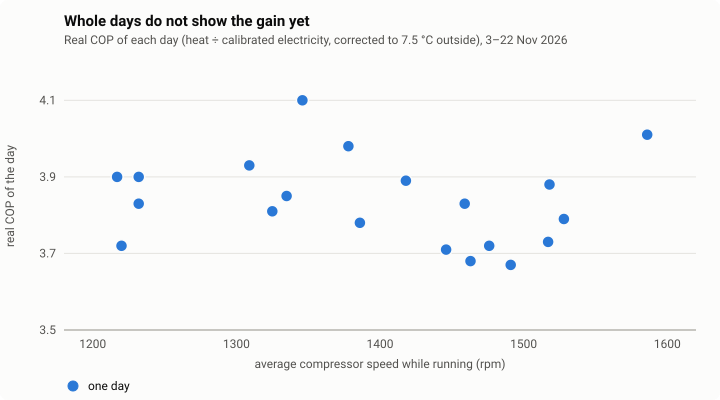

# COP, compressor speed and lift on a 12 kW unit

What three weeks of data from one LG Therma V R290 (12 kW, radiators, no DHW
tank) say about its efficiency: how much electricity it really uses, how good
the COP really is, and why the compressor works better at about 1,700 rpm than
at 1,400 rpm. The unit is the one in [findings.md](findings.md).

> **Status: in testing.** The analysis below led to a simpler AutoTemp that
> heats at the target from the start instead of holding the compressor back
> (see [What is being tested now](#what-is-being-tested-now)). It runs on the
> 12 kW unit from 23 November 2026; this page gets the results after a week or
> two. Until then, the example automations in [automations.md](automations.md)
> stay as they are.

## Contents

- [In short](#in-short)
- [The data](#the-data)
- [Electricity: the unit's figure is about 45 % too high](#electricity-the-units-figure-is-about-45--too-high)
- [Heat: reported and calculated agree, the flow sensor sets the limit](#heat-reported-and-calculated-agree-the-flow-sensor-sets-the-limit)
- [Lift: what the compressor has to overcome](#lift-what-the-compressor-has-to-overcome)
- [COP over compressor speed](#cop-over-compressor-speed)
- [Why faster is more efficient](#why-faster-is-more-efficient)
- [The catch: more heat needs warmer water](#the-catch-more-heat-needs-warmer-water)
- [Whole days](#whole-days)
- [What is being tested now](#what-is-being-tested-now)
- [How to repeat this on your own unit](#how-to-repeat-this-on-your-own-unit)
- [Limits](#limits)

## In short

| Finding | Result | Confidence |
|---|---|---|
| Electrical Power (input 34–45) against the house meter | about **1.45 ×** the real power (real ≈ 0.69 × unit) | 🟢 31 starts and stops, 3–22 Nov |
| Real COP at 1,400 rpm, about 6 °C outside | about **3.7** (the unit's own figures say 2.7) | 🟡 the flow sensor allows ±13 % |
| Real COP at 1,700 rpm, same conditions | about **4.3** | 🟡 same |
| Gain from 1,400 to 1,700 rpm at the same lift | **+0.5 COP** | 🟢 210 matched minutes, 96 % of them better |
| Cost of each kelvin of lift | about **−0.115 COP** (about 3 %) | 🟢 fitted over 5,700 minutes |
| Net gain once the radiators need warmer water | about **+0.4 COP** at 1,700 rpm | 🟡 radiator part estimated, not measured |
| Whole days | **no gain visible yet** | 🔴 20 days, faster days were also colder |

## The data

- **Unit:** Home Assistant history of this integration, exported as CSV: compressor speed, *Electrical Power*, *Thermal Power (Reported)* and *(Calculated)*, flow, outdoor temperature, evaporator coil, high and low pressure. Only the minutes Home Assistant keeps raw were used (it keeps 10 days raw; older days are hourly averages and were left out), from two exports: **3–22 November 2026**, 20 days.
- **House meter:** the smart meter read by vzlogger, exported from VictoriaMetrics as 30-second averages (`query_range` with `avg_over_time(...[30s])`, `step=30s`, in parts of eight days, as the API returns at most about 30,000 points per request).
- **Steady running:** compressor on for at least 20 minutes, the speed stable within ±30 rpm over 10 minutes, thermal power above 200 W, electrical above 300 W. **No defrosts:** minutes with a flow above 20 L/min or negative calculated heat, and the 15 minutes after them, were left out (the pump runs at about 34 L/min during a defrost).
- That leaves **5,713 steady minutes**.

## Electricity: the unit's figure is about 45 % too high

At every compressor start (about 08:00) and stop (about 16:00), the step in the house meter is the heat pump's real share: the rest of the house does not change within those few minutes, and at those hours there is little solar on the meter. The mean of five minutes before and after was compared, after the compressor had settled (8–13 minutes after a start, 2–7 minutes after a stop). Events where the house load itself jumped at the same time were left out (31 of 43 remained).

| Event | Unit's figure | House meter | House ÷ unit |
|---|---|---|---|
| Start, 22 Nov 08:02 | +1,462 W | +1,091 W | 0.75 |
| Start, 15 Nov 08:02 | +1,485 W | +1,125 W | 0.76 |
| Stop, 14 Nov 16:47 | −2,024 W | −1,542 W | 0.76 |
| Stop, 6 Nov 14:30 | −1,890 W | −1,455 W | 0.77 |
| Start, 7 Nov 08:32 | +1,482 W | +869 W | 0.59 |
| **All 31 (median)** | | | **0.69** (half between 0.67 and 0.75) |

Fitted over the range seen (1,300–2,000 W): **real ≈ 0.89 × unit − 300 W**. The error is relatively larger at low power. This matches the night pulses in [findings.md](findings.md#at-night-fan-runs-and-compressor-preheating) (about 300 W by the unit, about 200 W by the meter). Every COP built on *Electrical Power* is therefore too low; the "real" COP on this page uses the fitted line.

## Heat: reported and calculated agree, the flow sensor sets the limit

- *Thermal Power (Calculated)* is flow × (outlet − inlet) × 4186 J/(kg·K). With the compressor running, calculated ÷ reported has a median of **1.004** (half between 0.993 and 1.014). The unit evidently computes its reported heat from the same sensors, so the two are **not independent** of each other.
- **Temperature sensors:** at night, with the pump running and no heat, the calculated heat was exactly 0 W on all 2,640 minutes (1–5 am, 12–22 November): inlet and outlet read the same. An offset of 0.1 K would show up as about 80 W, so with the usual 6–7 K difference the zero error is below about 1.5 %.
- **Flow sensor:** a SIKA VVX20 (vortex, 5–80 L/min), datasheet accuracy ±2 % of the range, i.e. about **±1.5 L/min**; at 11–12 L/min that is up to **±13 %**. Its repeatability is ±0.5 %, so comparisons between minutes are reliable, the absolute level is not.

So all COPs here carry the flow sensor's uncertainty as one common factor: the *shape* of every result holds, the *level* may be up to about 13 % higher or lower. A heat meter in the heating circuit (MID class, about ±2–3 %) would pin it down.

## Lift: what the compressor has to overcome

The **lift** is the condensing temperature minus the evaporating temperature of the refrigerant, both worked out from the pressures (propane saturation, the pressures read as gauge pressure, see [findings.md](findings.md#the-pressures-are-gauge-pressures)). It is the temperature step the compressor has to pump the heat up. The smaller it is, the better the COP can be. The ideal (Carnot) COP for a lift is *T*condensing / lift in kelvin: at 43 °C and 40 K, 316 / 40 = 7.9.

Minutes at 5–7.5 °C outside:

| Speed | Minutes | Evaporating | Condensing | Lift | Water ΔT | Real COP | Share of ideal |
|---|---|---|---|---|---|---|---|
| below 1,300 rpm | 160 | 2.6 °C | 31.9 °C | 🟢 29.3 K | 5.6 K | 4.61 | 0.45 |
| 1,300–1,500 rpm | 1,539 | 2.6 °C | 42.7 °C | 🟡 40.3 K | 6.1 K | 3.61 | 0.45 |
| 1,550–1,650 rpm | 250 | 1.8 °C | 44.7 °C | 🟡 42.1 K | 6.9 K | 3.69 | 🟢 0.49 |
| 1,650–1,750 rpm | 106 | 1.8 °C | 43.7 °C | 🟡 42.0 K | 7.0 K | 3.89 | 🟢 0.51 |

Fitted over all steady minutes:

- **lift ≈ 0.93 × condensing − 0.89 × outdoor + 4.2 K per 1,000 rpm.** The water temperature sets the lift almost one to one; the speed adds a little, because a faster compressor pulls the coil colder and pushes the condenser warmer.
- **COP falls by about 0.115 per kelvin of lift** (about 3 %). The first row shows what that means: with water at about 32 °C instead of 43 °C, the lift is 11 K smaller and the COP 1 point higher.

## COP over compressor speed

To see the speed alone, each minute's real COP was moved to a common lift of 40 K with the 0.115 per kelvin from above, and the minutes were grouped per 50 rpm.

- **Up to about 1,400 rpm the curve is flat** at about 3.5–3.6.
- **From about 1,450 rpm it rises steadily**, by about 0.25 per 100 rpm, to about 4.4 at 1,700 rpm, with no sign of levelling off yet.
- The unit's own COP has the same shape, about one point lower: its electricity figure is too high.
- Above 1,750 rpm there was no steady running in the data, so the curve beyond is unknown. The bins below 1,100 rpm come from mild days with only about 27 K lift and need the largest correction; they are the least certain.

**Without the lift correction, matched instead:** every minute at a higher speed was compared with minutes at 1,300–1,500 rpm with the same outdoor temperature (±0.5 K) and the same condensing temperature (±1 K):

| Speed | Matched minutes | Real COP | Better in |
|---|---|---|---|
| 1,550–1,650 rpm | 346 | 🟢 +0.20 | 90 % |
| 1,650–1,750 rpm | 210 | 🟢 +0.49 | 96 % |

Sensor lag cannot explain it: during a speed-up the heat reading lags behind the electricity, which would make the faster minutes look *worse*. With the speed stable for 10 minutes the gap was, if anything, slightly larger.

## Why faster is more efficient

In the lift table, the share of the ideal COP rises from **0.45 at 1,400 rpm to 0.51 at 1,700 rpm**: the compressor itself works better. 1,400 rpm is about 23 Hz, the bottom of an inverter compressor's range. At low speed, more refrigerant leaks back inside the compressor and the motor and its inverter run at poor efficiency, so the same heat costs relatively more electricity. Compressors of this kind usually work best somewhere around 50–60 Hz (3,000–3,600 rpm); the data so far only reach 1,750 rpm.

## The catch: more heat needs warmer water

Faster also means more heat: about 5.8 kW at 1,700 rpm instead of 4.8 kW at 1,400 rpm. The house can only take more heat through the radiators if they are warmer: their output grows with about the 1.3rd power of their temperature above the room. Assuming the water is now about 19 K above the room (about 39 °C mean against 20 °C), 20 % more heat needs about **3 K warmer water**, which adds 3 K of lift.

| Effect of 1,400 → 1,700 rpm | Real COP | Source |
|---|---|---|
| Compressor works better (same lift) | +0.87 | 🟢 measured |
| Evaporator about 1 K colder | −0.12 | 🟢 measured |
| Water about 3 K warmer for the radiators | −0.33 | 🟡 estimated (standard radiators) |
| **Net** | **+0.43** (3.56 → about 4.0) | 🟡 |

With 30 % more heat instead of 20 % (as the raw medians suggest), the net is still about +0.3. With smaller radiators the water penalty grows.

What the house needs per day does not change: delivering, say, 40 kWh of heat at a COP of 3.56 takes 11.2 kWh of electricity, at 4.0 it takes 10.0 kWh (−11 %), in about 6.9 instead of 8.4 hours. The extra power is not the gain, the better COP is; if the faster heating also makes the house warmer than before, it loses more (about 6 % per kelvin indoors), and part of the gain goes into that.

## Whole days

The real COP of each day (heat ÷ calibrated electricity), corrected to 7.5 °C outside, over the day's average speed:

The faster days came out *worse*, not better. That does not contradict the minutes: on this unit the speed is set by demand, so the faster days were the colder ones, with more defrosting and warmer water, and a simple outdoor correction removes only part of that. Twenty days cannot separate it. Whether the gain per minute survives a whole day has to be tested on purpose.

## What is being tested now

From 23 November 2026, on the 12 kW unit:

- **Max compressor modulation 45 %** instead of 40 % (40 % mostly gave about 1,500–1,600 rpm, 45 % should give about 1,650–1,750 rpm; the stop automation resets it to 45 % each evening).
- **A simpler AutoTemp:** once the compressor has run 1 minute, inlet control and the setpoint straight to the target (38 °C at 0 °C outside, 33 °C at 15 °C, linear in between), so the unit heats at the cap until the water gets there and then holds it on its own. No cold start, no following, no morning ramp. Kept: **frost protection** (straight to just below the inlet so the unit throttles at once, then 1 °C every 2 minutes; back up 1 °C every 5 minutes once the coil is above 1 °C again), a **thermo off guard** (inlet 3 K above the setpoint → +1 °C up to 40 °C, back down to the target once the water has cooled), and the **oil boost**.
- It also warms the house earlier in the day, which is wanted, and costs some heat.

After a week or two, the same exports (Home Assistant history within 10 days, the house meter from VictoriaMetrics) decide: real kWh of electricity per day, real COP per day, compressor starts and defrosts per day (2.3.0 counts them), each against days with similar outdoor temperatures from 3–22 November. If it holds up, the new AutoTemp replaces the example in [automations.md](automations.md).

## How to repeat this on your own unit

1. **A meter for the heat pump**, or the house meter. With the house meter, use the steps at compressor starts and stops, at times with little else switching and no solar ramp.
2. **Raw data:** export the Home Assistant history (*History → ⋮ → Download data*) within 10 days, or read it from a long-term store. Hourly averages hide the starts and stops.
3. **Lift** from the two pressures: saturation temperature of propane at (gauge pressure + 1.013) bar, e.g. with CoolProp `PropsSI('T', 'P', p_abs_pa, 'Q', 1, 'Propane')`.
4. **Steady minutes only**, no defrosts, then group by speed at the same lift or matched outdoor and condensing temperature.

## Limits

- One unit, one house, radiators, 20 days in November at about 0–14 °C outside.
- The absolute COP level rests on the flow sensor (±13 %); the comparisons between speeds do not.
- The electricity calibration covers 1,300–2,000 W; outside that range the fitted line is an extrapolation.
- The radiator penalty is an estimate with standard radiator physics, not a measurement in this house.
- No steady data above 1,750 rpm yet.
